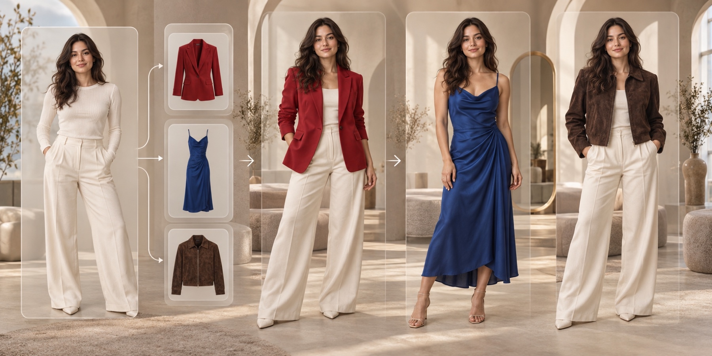

# SameMuse

### Private AI virtual try-on before you buy

[Visit Website](https://samemuse.com/) · [Try It](https://samemuse.com/#try-on) · [Shopping Screenshots](https://samemuse.com/change-clothes-in-photo) · [Menswear](https://samemuse.com/for-men) · [Pricing](https://samemuse.com/pricing)

## What is SameMuse?

[SameMuse](https://samemuse.com/) is a private, reference-based AI clothes changer for people who want to preview a garment on their own photo before ordering online.

Start with a clear photo of yourself, add the clothing you are considering, and generate a personalized visual preview. The garment reference can be a product photo, flat lay, shopping screenshot, worn example, public product image, or supported product-page link.

## How it works

1. Upload a clear full-body or waist-up photo.
2. Add one garment or outfit reference from an image, screenshot, or public link.
3. Generate a private Standard or HD preview, usually ready in about a minute.
4. Keep the same person photo and try additional references to compare different looks.

## What you can explore

- **Shopping previews** from product images and cropped store screenshots
- **Single-garment swaps** for shirts, jackets, knitwear, dresses, and other visible items
- **Outfit comparisons** using the same person, pose, and setting as the visual anchor
- **Menswear previews** for shirts, overshirts, jackets, knitwear, and occasion looks
- **Side-by-side decisions** with up to four generated looks on one comparison board

## Common use cases

### Compare before checkout

Test color, silhouette, garment length, and overall styling before committing to an online purchase.

### Reuse a shopping screenshot

Crop away navigation, prices, and unrelated products, then use the remaining garment as the visual reference.

### Keep the person consistent

Use one person photo across several generations so differences between clothing options are easier to judge.

### Explore menswear

Preview shirts, jackets, knitwear, and formal looks while keeping the original photo as the identity and proportion reference.

## Product highlights

| Capability | What it does |
| --- | --- |
| Reference-based try-on | Combines a person photo with a real garment or outfit image |
| Flexible garment input | Accepts product photos, flat lays, screenshots, worn references, and supported public links |
| Identity-first workflow | Uses the original face, pose, body proportions, and scene as visual anchors |
| Standard and HD results | Offers a fast Standard preview and an HD option for signed-in users with credits |
| First preview without signup | Provides an eligible first Standard try-on without requiring an account |
| Private retention policy | Deletes person photos, garment references, and results after seven days |
| No training use | Uses uploaded photos and results for the requested try-on, not model training |

## Explore SameMuse

| Destination | Link |
| --- | --- |
| Main AI clothes changer | [Open SameMuse](https://samemuse.com/#try-on) |
| Change clothes from a screenshot | [View the screenshot workflow](https://samemuse.com/change-clothes-in-photo) |
| Swap one visible garment | [Try AI Clothes Swap](https://samemuse.com/ai-clothes-swap) |
| Compare a different look | [Explore AI Outfit Changer](https://samemuse.com/ai-outfit-changer) |
| Create a reference-based outfit preview | [Explore AI Outfit Generator](https://samemuse.com/ai-outfit-generator) |
| Preview menswear | [Open SameMuse for Men](https://samemuse.com/for-men) |
| Plans and credits | [View pricing](https://samemuse.com/pricing) |

## Review before buying

SameMuse creates a visual approximation, not an exact sizing or fit prediction. Review the face, hands, garment edges, logos, patterns, and background in every generated image. Use the retailer's size chart, fabric information, measurements, and return policy for the final purchase decision.

Only upload photos and garment references that you own or are authorized to use.

## About this repository

This is the public product overview repository for SameMuse. The application source code is proprietary and maintained privately. For product access, current features, pricing, and support, visit [samemuse.com](https://samemuse.com/).
